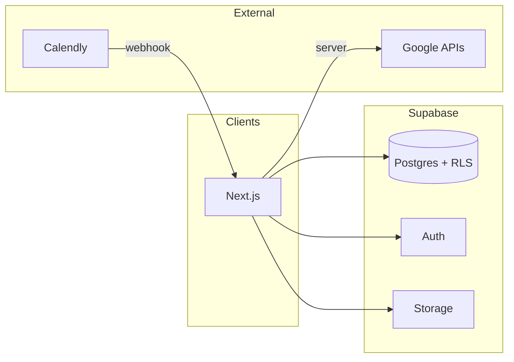

# Best Day — Final Backend Architecture

NZ-first telehealth. **Supabase** is the system of record. Next.js App Router for UI and server logic.

## 1. System overview

- **Public marketing + prescreen** → creates/updates **leads**; conversion links **auth.users** + **customers**.
- **Booking** → Calendly (UX) + webhooks → **appointments** in Postgres; optional **Google Calendar** mirror.
- **Clinical** → doctors see assigned **consultations** / **cases**; outcomes drive **product_recommendations**.
- **Commerce** → **products** catalogue; **orders** + **shipments** / delivery status.
- **Support** → **tickets** with messages; optional Gmail thread correlation.
- **Notifications** → Gmail API (Workspace) for operational email; Supabase Auth handles auth emails.
- **Documents** → metadata in Postgres; binary in **Supabase Storage** and/or **Google Drive** (IDs stored in DB).
- **Governance** → **audit_logs** (append-only via service role); **RBAC** via `profiles.role` + RLS.



## 2. Route architecture

| Area | Path prefix | Layout | Purpose |
|------|-------------|--------|---------|
| Marketing | `/`, `/home`, `/about`, `/pricing`, … | `(marketing)` | Public site + prescreen |
| Auth | `/login`, `/auth/callback` | `(auth)` | Login, OAuth/magic callback |
| Customer portal | `/portal`, `/portal/*` | `(portal)` | Bookings, orders, tickets, profile, documents |
| Admin | `/admin`, `/admin/*` | `(staff)` | Users, fulfilment, catalogue, tickets queue |
| Doctor | `/doctor`, `/doctor/*` | `(staff)` | Patients, consultations, recommendations |
| Master | `/admin` (elevated) | same as admin | Break-glass; extra policies + audit |

**API (Route Handlers):** `app/api/webhooks/calendly/route.ts` (future: Google push). **Server Actions** for mutations from trusted UI.

## 3. Database schema (target)

**Identity & access**

| Table | Purpose |
|-------|---------|
| `profiles` | `id` = `auth.users.id`, `role`, `full_name`, contact fields; RLS by role |
| `customers` | Business patient record: `user_id` FK, demographics, NZ-specific flags, status |

**Funnel**

| Table | Purpose |
|-------|---------|
| `leads` | Prescreen submissions before/without account; `email`, answers JSON, `eligibility_status`, `converted_user_id` |

**Scheduling**

| Table | Purpose |
|-------|---------|
| `appointments` | `calendly_event_uri`, `starts_at`, `status`, `customer_id`, `doctor_id` (nullable until assigned) |

**Clinical**

| Table | Purpose |
|-------|---------|
| `consultations` | Links customer, doctor, appointment; status, notes reference |
| `clinical_notes` | Structured access; strict RLS (doctor + assigned; customer limited) |
| `product_recommendations` | Doctor-approved lines: `product_id`, `customer_id`, `status` |

**Commerce**

| Table | Purpose |
|-------|---------|
| `products` | SKU, name, regs metadata, `active` |
| `orders` | Customer, totals, status (`draft` → `paid` → `fulfilled`) |
| `order_items` | Product, qty, price snapshot |
| `shipments` | Carrier, tracking, status, `order_id` |

**Support**

| Table | Purpose |
|-------|---------|
| `tickets` | Subject, status, priority, `customer_id`, assignee `profiles.id` |
| `ticket_messages` | Body, author, internal flag |

**Documents**

| Table | Purpose |
|-------|---------|
| `documents` | `storage_path` or `drive_file_id`, `kind`, `customer_id`, visibility |

**System**

| Table | Purpose |
|-------|---------|
| `audit_logs` | `actor_id`, `action`, `entity_type`, `entity_id`, `metadata`, `created_at` |
| `reminder_jobs` (optional) | Idempotent reminder scheduling: `send_at`, `channel`, `payload`, `sent_at` |

*Phase 1 delivers `profiles`, `audit_logs`, and auth trigger; other tables land in later phases.*

## 4. Auth model

- **Supabase Auth** — email magic link and/or password (product decision per environment).
- **`profiles`** row created on signup via **trigger** on `auth.users`; default `role = customer`.
- **Staff** — `master` / `admin` / `doctor` set via **service role** (invite flow or admin UI), never trust client `raw_user_meta_data` alone without server verification.
- **Session** — HTTP-only cookies via `@supabase/ssr`; **middleware** refreshes session.

## 5. RBAC rules (RLS + app guards)

- **Customer** — CRUD on own `customers` row (via `user_id`), own `orders`, `tickets`, `appointments`, readable `documents` for self.
- **Doctor** — Read/update `consultations` / patients **assigned** or **explicit share**; insert `product_recommendations` for assigned patients; no admin settings.
- **Admin** — Operational: orders, shipments, tickets queue, products, read profiles for support; no destructive Master-only actions (optional split).
- **Master** — Full read on audit; user role promotion; override flags; all admin capabilities; **must** emit audit row on sensitive actions.

**Middleware** enforces route prefixes (`/portal` = any authenticated; `/admin` = master|admin; `/doctor` = doctor|admin|master). **RLS** is the final authority on data.

## 6. Google integration architecture

| Capability | Mechanism |
|------------|-----------|
| Gmail send | Workspace **service account** + domain-wide delegation *or* dedicated **robot mailbox** + OAuth (server-only refresh token). Next **Route Handlers / server actions** call Gmail API. |
| Calendar | Service account or doctor OAuth; sync **appointments** on confirmation. |
| Drive / Docs / Sheets | Service account folder; store `drive_file_id` on `documents`; **Docs API** for generated letters if needed. |

Secrets: `GOOGLE_*` env vars; **no** keys in client. Token refresh on server only.

## 7. Calendly integration flow

1. User completes prescreen (eligible) → **portal** or marketing page shows **Calendly embed** (per event type / practitioner).
2. Calendly sends **webhook** (`invitee.created`, `canceled`, etc.) → `POST /api/webhooks/calendly` with signature verification.
3. Handler upserts **appointments**, optionally enqueues **reminder_jobs**.
4. Optional: create **Google Calendar** event for clinic calendar.

## 8. Notification architecture

| Type | Channel |
|------|---------|
| Auth (magic link, reset) | Supabase Auth email (SMTP or Supabase default) |
| Booking confirmation / reminders | Gmail API templated sends |
| Order shipped | Gmail + in-app portal status |
| Ticket updates | Gmail optional + portal |

**Idempotency** — `reminder_jobs.sent_at` or message-id log to prevent duplicates.

## 9. Document / file handling

- **PHI/patient files** — Supabase **Storage** private buckets; signed URLs short-lived; path in `documents.storage_path`.
- **Templates / exports** — Google Docs/Sheets; link stored in DB.
- **RLS** on `documents` aligned with customer vs staff visibility.

## 10. Ticketing architecture

- **tickets** + **ticket_messages** as relational model; optional `external_thread_id` for Gmail.
- **Customer** creates ticket from portal; **Admin** assigns and responds; **internal** flag on messages for staff-only notes.
- **SLA / priority** on `tickets` for dashboard sorting.

## 11. Audit logging architecture

- **audit_logs** — append-only; **no** client INSERT policies; writes via **`createAdminClient()`** server-side only.
- Log: role changes, order status changes, document access exports, Master overrides, ticket assignment.
- **Retention** policy documented for NZ Privacy Act / health codes.

---

## Role permissions matrix (summary)

| Resource | Customer | Doctor | Admin | Master |
|----------|----------|--------|-------|--------|
| Own profile | R/U | R/U | R | R |
| Other profiles | — | assigned subset | R (ops) | R |
| Leads | own draft | — | R/W | R/W |
| Appointments | own | assigned | R/W | R/W |
| Consultations / notes | limited | assigned | — | R |
| Recommendations | own approved | create/update own | R | R/W |
| Products | R active | R | R/W | R/W |
| Orders | own | — | R/W | R/W |
| Tickets | own | — | R/W | R/W |
| Audit logs | — | — | — | R |
| Role assignment | — | — | — | W |

---

## Integration map

```
Next.js server ──► Supabase (Auth, Postgres, Storage)
Next.js server ──► Gmail API (notifications)
Next.js server ──► Google Calendar / Drive / Docs (as needed)
Calendly ──webhook──► Next.js /api/webhooks/calendly
```

---

## Phased build order

1. **Phase 1** — Supabase deps, clients, middleware, `profiles` + `audit_logs`, auth pages, route groups, `/portal` `/admin` `/doctor` stubs, `.env.example`.
2. **Phase 2** — `leads`, prescreen persistence, eligibility, customer conversion.
3. **Phase 3** — Calendly webhook, `appointments`, reminders.
4. **Phase 4** — Doctor consultations, notes, recommendations.
5. **Phase 5** — Products, orders, shipments.
6. **Phase 6** — Tickets.
7. **Phase 7** — Admin dashboard depth, Master tools.
8. **Phase 8** — Google Drive/Docs/Sheets automation; hardening.

---

## Phase 1 (implemented in repo)

- Dependencies: `@supabase/supabase-js`, `@supabase/ssr`.
- **Apply** `supabase/migrations/20260403120000_phase1_profiles_audit.sql` in the Supabase SQL editor (or `supabase db push`).
- Supabase **Auth → URL configuration**: add `NEXT_PUBLIC_SITE_URL` (e.g. `http://localhost:3000`) and redirect allow-list `http://localhost:3000/auth/callback` (plus production URL).
- Enable **Email** provider and magic link / OTP as desired.
- Copy `.env.example` → `.env.local` and fill keys. Promote staff roles by updating `profiles.role` with the **service role** (SQL or Dashboard), never from the client.

*Document version: 2026-04-03*
